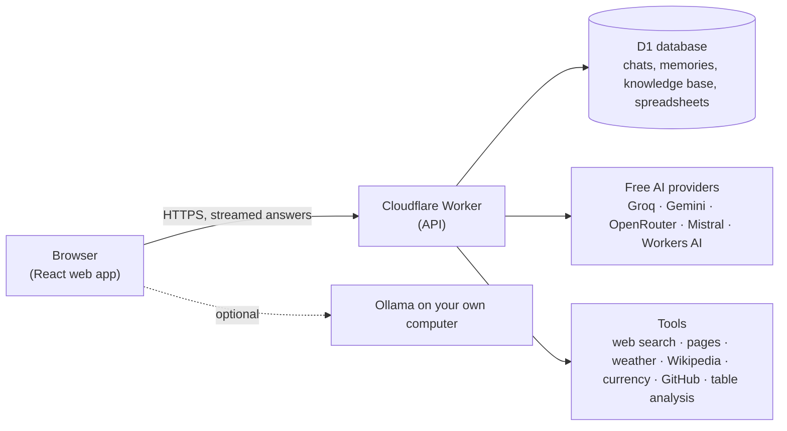

# VESPER

**A private, multi-user AI assistant that runs entirely on free tiers, answers from evidence, and shows you where
every answer came from.**

VESPER is a ChatGPT-style assistant you host yourself: a web app where people sign in, chat, search the live web,
ask about documents, spreadsheets and their own GitHub code, and get answers with sources they can check. It runs on Cloudflare's
free plan (Workers + D1 database) and switches automatically between free AI providers (Groq, Google Gemini,
OpenRouter `:free` models, Mistral and Cloudflare Workers AI), so it costs nothing to run and can't run up a bill.
An administrator manages users, limits, tools and models from a built-in admin panel.

Current version: **0.15.1**.

- [What VESPER does](#what-vesper-does)
- [How VESPER is different](#how-vesper-is-different)
- [Features](#features)
- [How it works](#how-it-works)
- [Install and set up](#install-and-set-up)
- [Using VESPER](#using-vesper)
- [Development](#development)
- [Security and privacy](#security-and-privacy)
- [Troubleshooting](#troubleshooting)

---

## What VESPER does

You ask a question; VESPER answers in a streaming, ChatGPT-like chat. Behind the scenes it decides whether the
question needs a look-up, fetches what it needs and cites it:

- **Everyday questions and writing**: explanations, drafts, code, maths (with an exact calculator), in Markdown with
  tables, code highlighting and formulas.
- **Current information**: it searches the web, reads pages, checks the weather, Wikipedia and exchange rates, and
  links every source under the answer.
- **Research**: the Research button turns a question into several planned searches and a written brief with a dated
  sources list.
- **Your documents**: the administrator adds PDFs, Word files, text or web pages to a knowledge base; answers cite
  "document, page X".
- **Your spreadsheets**: attach a CSV or Excel file and ask questions about it; totals, averages, counts and trends are
  calculated exactly over every row, the answer says what was calculated, and each result comes with a chart or table
  you can download as CSV.
- **Your code**: each user can connect their own GitHub (read-only) and ask about files, issues and pull requests.
- **Changes you approve**: VESPER can prepare a GitHub issue, comment or pull request; it shows the exact change on a
  card and sends it only when you press Approve.
- **Your calendar and email**: connect Google to ask what's on your calendar and when you're free (worked out exactly),
  and let VESPER prepare calendar events and emails. Each one is shown on a card (an email can still be edited) and
  added or sent only when you press Approve. VESPER can't read your inbox.
- **Checking answers**: one click rates an answer's key claims against the sources it used.
- **Remembering you**: notes you ask it to keep (preferences, projects), which you can see, pin, edit and delete.
- **Images and voice**: attach screenshots or photos, speak your question, or have answers read aloud.

## How VESPER is different

Most AI assistants are a single company's model behind a subscription. VESPER is built around a few different
choices:

1. **Free to run, with no way to be billed.** Hosting, database and AI all use free tiers. The code only ever calls
   free models (it refuses any OpenRouter model that isn't `:free`), and when one provider hits its limit it moves to
   the next free one instead of a paid fallback.
2. **Not tied to one AI company.** Five providers sit behind one router with automatic fallback, plus optional local
   models (Ollama) that run on your own computer.
3. **Evidence first, and checkable.** Sources are ranked (official and government sites first) and labelled with
   dates; the assistant follows written rules (newest reliable source wins, differing figures are shown side by
   side, never blended). Any answer that used sources can be checked claim by claim, and deep-research reports are
   checked automatically. Figures from your spreadsheets are calculated by the database over every row, never by the
   model.
4. **You own it.** The code is in your GitHub repository and the data is in your own Cloudflare database. There's no
   third-party account system: users sign in with Google, and you decide who can sign up and how much they can use.
5. **Safe with outside content.** Web pages, documents and repository text are treated as untrusted data, never as
   instructions. Reading GitHub uses a read-only app; changes use a separate app and are sent only after you approve
   each one on a card. Access is encrypted, and once private code is in an answer the assistant can't open other web
   pages (so planted text can't send your code elsewhere).
6. **A clean view for users, full detail for the admin.** Users see answers and sources; the administrator can also
   see which model answered, every tool step and an automatic number check.

## Features

**Chat and models**
- Streaming answers with Markdown, tables, code highlighting and maths; stop, regenerate, edit your last message,
  copy, read aloud.
- Conversation history in the cloud: search, rename, delete, links to any chat.
- Model menu: **Auto** (best free provider available) or models the admin makes available, with friendly names.
- Automatic fallback across free providers with cooldowns and clear error messages; long chats keep their context
  (the older part is summarised once into short notes instead of being dropped).
- Optional local models through [Ollama](https://ollama.com), called directly from your browser.

**Live information and sources**
- Web search (Tavily, free plan, capped per day by the admin), reading web pages, weather (Open-Meteo), Wikipedia
  and currency rates (Frankfurter).
- Results labelled *official / university / other website* with dates; trusted and blocked website lists in the
  admin panel; questions that clearly need a look-up are searched before the model answers.
- Numbered source chips under every answer that used sources: the pages the answer actually used, with the other
  search results one click away ("+N other results checked"). Links to code open GitHub on the exact lines.

**Answer quality**
- **Check this answer**: one extra model request lists the answer's key claims (up to 8) and marks each one
  *Supported*, *Contradicted* (with what the source says) or *Not in the sources*, naming the source. The result is
  saved with the answer.
- Deep-research reports are checked automatically.
- An admin-only number check flags figures in an answer that no source contains (general-knowledge numbers like
  "SPF 30" are left alone).
- 👍/👎 feedback with an optional reason; the admin sees ratings per model.

**Deep research**
- Plans 2–4 searches, reads up to 3 pages, then writes a brief: short answer, key findings, disagreements and what's
  uncertain, with a sources list showing published and checked dates (never guessed by the model).

**Knowledge base**
- The admin uploads PDF, Word (.docx), text, Markdown and CSV files or adds web pages, in folders. Files are read in
  the admin's browser; only their text is stored (roughly 15,000 pages fit in the free database).
- Full-text search plus Cloudflare's free re-ranker; answers cite "document, page X".

**Spreadsheets (data analysis)**
- Attach a CSV, TSV, Excel (.xlsx, .xlsm, .xls) or OpenDocument (.ods) file with the paperclip (or drag it in): up to
  10 MB and 50,000 rows, one per message, five per chat. Every sheet with data becomes a table.
- The file is read in your browser: VESPER finds the header row (titles above it are skipped), works out each column's
  type (numbers, dates, yes/no, text) and understands "$1,200", "(45)", "12,5%", "05/03/2026" or "5 Mar 2026". Codes
  such as "00123" stay text, "n/a" and "-" count as empty, and a "Total" row at the end is left out so nothing is
  counted twice. Excel dates, percentages and currencies are read from the cell formats.
- Ask in plain words: "total sales by region", "average order in March", "top 5 customers", "how many rows have no
  email", "compare 2025 and 2026 by month". The assistant says what to calculate (filters, grouping by value or by
  year, quarter, month, week, day, weekday or hour, and sum, average, count, different values, lowest, highest or
  median) and the database works it out over every row. The model never does the arithmetic and never writes
  database code: the query is built from fixed parts and every value is passed separately.
- Under the answer, a chip such as "sales.xlsx · sum of Amount by Region · where Date in 2026" shows what was
  calculated; **Check** works on these answers too.
- **Charts and downloads** (v0.14.1): each calculation also appears under the answer as a card with the whole result.
  The chart is chosen for you:
  - **a line** for figures over time (by year, quarter, month, week, day or hour). A period with no rows counts as 0 for
    totals and counts and is a gap for averages.
  - **bars** for other groupings, each with its figure.
  - **one line per value** for "by month and region" (up to four values, with a legend).
  - **a table** for lists of rows and anything else.

  Hover, tap or use the arrow keys to read a point. Switch between **Chart** and **Table**, and pick the figure when
  there are several (one at a time, never two scales on one chart). **Download CSV** saves the result with exact
  values; it opens correctly in Excel, Urdu text included, and text that Excel could run as a formula is kept as plain
  text. A result can hold up to 500 groups or 200 listed rows; the card says when only the first ones are shown. Ask
  "make a chart of sales by month" or "list the overdue invoices so I can download them".
- The AI provider gets the column overview, three example rows and the results, not the whole file. The rows are kept
  with the chat and deleted with it; a file you remove before sending is deleted at once, one never sent after a day.

**Google Calendar and Gmail (with your approval)**
- Settings → Connections → **Connect Google**: pick your Google account and tick what VESPER may use: your calendar's
  events, sending email, or both. This is separate from signing in with Google.
- Ask "what's on my calendar this week?" or "when am I free for an hour on Thursday?". Free time is worked out by the
  server from your events, in your time zone: events shown as free and invitations you declined don't count.
- Ask "add a meeting with sara@example.com tomorrow at 3" (or "…and remind me 30 minutes before") or "email Ali that
  the report is ready". VESPER prepares it
  on a card with exactly what will happen:
  - an event: time, place, guests, Meet link, reminders, and any clash with your calendar;
  - an email: recipients, subject and text, which you can still edit.

  Nothing is added or sent until you press **Approve**; guests get Google's invitation only then. Cards expire after
  24 hours.
- The card warns about addresses you never typed in the chat, and when the answer also read your calendar, files or
  code.
- VESPER asks Google for the narrowest permissions: events on calendars you own, and sending email. It can't read your
  inbox. While VESPER's Google app is in testing, only its test users can connect, and Google ends the connection every
  7 days (reconnect in Settings).

**Your GitHub (read-only)**
- Each user connects their own GitHub in **Settings → Connections** and picks which repositories VESPER may read.
- Ask VESPER to explain a repository, read a file (with line numbers), search the code, list or open issues and pull
  requests, or review a pull request's changes. Big pull requests are reviewed in parts, code first.
- Answers link to the exact commit and lines on GitHub. This connection can't change anything on GitHub.

**GitHub changes, only with your approval**
- A separate connection (**Settings → Connections → GitHub changes**) with its own repository choice, so reading never
  comes with write access.
- Only in repositories **you can write to** (your own, or ones you're a collaborator on): VESPER won't post issues or
  comments in other people's public repositories, and it checks your access again when you approve.
- Ask VESPER to open an issue, comment on an issue or pull request, or make a pull request that changes files. It
  prepares the change and shows a card with the exact text, or every changed line; nothing is sent until you press
  **Approve**. **Reject** sends nothing; an undecided card expires after 24 hours.
- Pull requests always go on a new `vesper/…` branch from the default branch. VESPER never writes to existing
  branches, never merges and never deletes. If someone changed the same files on GitHub in the meantime, nothing is
  sent.
- The card warns when VESPER read text written by others while preparing it, and when private code was read before a
  change to a public repository. Every change is logged under **Recent changes**.

**Memory**
- Each message gets your pinned memories plus the ones related to it; view, add, pin, edit, export and delete them in
  **Settings → Memory**.
- Passwords, card and bank numbers, ID card numbers and phone numbers are refused.

**Images and voice**
- Attach, paste or drag in up to 3 images per message; they're resized in your browser and sent only to models that
  can see them. Only a small preview is kept.
- Speak your message (Groq's free Whisper, Cloudflare's as backup; English and Urdu) and check the text before
  sending; "Read aloud" uses your device's own voices.

**Accounts and administration**
- Google sign-in for everyone (no passwords stored); GitHub sign-in as a backup for administrators.
- Admin panel: users (block, delete, personal daily limits), sign-ups open or closed, daily limits for messages,
  images, voice, research, answer checks and spreadsheets, instructions for the assistant, tools on or off for everyone, which
  models users may pick, the knowledge base, feedback, provider status.
- Light, dark and system themes (dark by default), a responsive mobile layout and a logo that follows the theme.

## How it works



What happens when you send a message:

1. The Worker checks your sign-in, your daily limit and the request.
2. It builds the prompt: VESPER's answer rules, the administrator's instructions, your relevant memories, short
   notes on the older part of a long chat, and the recent messages.
3. If the question clearly needs a look-up (latest news, "according to…", your documents), the search runs first, so
   the model can answer in a single request. In a chat with a spreadsheet this is skipped: "sales in 2026" is about
   the file.
4. The router sends the request to the first free provider that's available. On a rate limit or error it moves to
   the next one and remembers the cooldown.
5. The model may call tools (up to 5 rounds). Every tool result is passed as untrusted data, with its source.
6. The answer streams back to your browser word by word, with the source chips underneath.
7. The answer is saved with its tool steps and a copy of what its sources said (for GitHub, only references to the
   exact files), so it can be checked later with **Check**.

| Part | Technology |
|---|---|
| Web app | React, Vite, Tailwind CSS; SheetJS Community Edition for Excel files (read in a background worker) |
| API | Cloudflare Workers, Hono, zod validation, Server-Sent Events for streaming |
| Database | Cloudflare D1 (SQLite) with add-only migrations |
| AI | Groq, Google Gemini, OpenRouter (`:free` only), Mistral, Cloudflare Workers AI; Ollama optional |
| Tests | Vitest running inside the Workers runtime with a real local D1 (298 tests) |
| Delivery | GitHub Actions: checks on every pull request, deploy on merge to `main` |

More detail: [docs/ARCHITECTURE.md](docs/ARCHITECTURE.md).

### How it stays free

| Piece | Service | Free allowance | What happens at the limit |
|---|---|---|---|
| Hosting + API | Cloudflare Workers (Free plan) | 100,000 requests/day, 10 ms CPU per request | Requests fail until 00:00 UTC. **No billing.** |
| Web app files | Workers static assets | Unlimited requests | n/a |
| Database | Cloudflare D1 | 5 GB storage, 5M rows read/day, 100k rows written/day | Queries fail until 00:00 UTC. **No billing.** Spreadsheet calculations have their own daily share (2M rows by default), so they can't use it all up. |
| AI | Groq free plan | ~30 req/min, ~1,000 req/day, 8K tokens/min per model | VESPER switches provider |
| AI | Google Gemini free tier | Per-project limits (Flash-Lite allows the most) | VESPER switches provider |
| AI | OpenRouter `:free` models | 20 req/min, 50 req/day | VESPER switches provider |
| AI | Mistral "Experiment" plan | Conservative rate limits | VESPER switches provider |
| AI | Cloudflare Workers AI | 10,000 neurons/day | Fails until 00:00 UTC. **No billing.** |
| Web search | Tavily free plan | 1,000 searches/month (VESPER caps it per day) | Web search pauses until the next day |
| GitHub | GitHub API | 5,000 requests/hour per user | VESPER says so and tries again later |
| CI/CD | GitHub Actions | Unlimited for public repositories | Waits until next month (private repos) |

Keep it free on your side: don't add a card to Groq, use a Gemini key from a Google Cloud project **without billing
enabled**, stay on Mistral's free Experiment plan and Cloudflare's Free plan. Free-tier numbers were checked in
November 2026 and change often; VESPER reads live model lists and handles limits as they come.

**Privacy note:** the free tiers of some providers (for example Gemini and Mistral) may use prompts to improve their
models. Don't send confidential data through them; use Groq or local models for private work.

---

## Install and set up

### 1. Try it on your computer

Requirements: Node.js 22.12+ and Git. No Cloudflare account or API keys are needed for a local try-out.

```bash
git clone https://github.com/RajaFarazTariq/VESPER-AI.git
cd VESPER-AI
npm install
cp .env.example .env        # then edit .env (see below)
npm run dev                 # API on :8787, web app with hot reload on http://localhost:5173
```

Minimum `.env` to run **without any API keys**, using the bundled offline mock of the AI APIs:

```ini
APP_NAME=VESPER
ADMIN_GITHUB_USERS=your-name
DEV_LOGIN=true
WORKERS_AI_ENABLED=false
GROQ_API_KEY=mock
GROQ_BASE_URL=http://127.0.0.1:8790/groq
```

In a second terminal run `npm run mock:llm`, open http://localhost:5173 and use the *local development login*: the
name you put in `ADMIN_GITHUB_USERS` opens the admin panel; any other name is a regular user. To use real models
locally, put real keys in `.env` and remove the `*_BASE_URL` line. Local data lives in `.wrangler/` (git-ignored).

### 2. Deploy your own copy (free)

Step-by-step guide: **[docs/DEPLOYMENT.md](docs/DEPLOYMENT.md)**. Every setting, secret and account a deployment uses
(names and where they live, never the values) is listed in **[docs/CONFIGURATION.md](docs/CONFIGURATION.md)**. In
short:

1. Put this project in your own GitHub repository.
2. Create a free Cloudflare account, a D1 database and an API token.
3. In the GitHub repository add the `CLOUDFLARE_API_TOKEN` and `CLOUDFLARE_ACCOUNT_ID` secrets and the
   `D1_DATABASE_ID` variable.
4. Merge to `main`: GitHub Actions runs the checks, applies database migrations and deploys.
5. Create a Google OAuth client (sign-in for everyone), optionally a GitHub OAuth app (admin backup sign-in), and add
   your keys and admin email in Cloudflare (next section).

After that everything runs in Cloudflare; the copy on your computer isn't needed any more.

### 3. Configuration

In production, set these in **Cloudflare → Workers & Pages → your Worker → Settings → Variables and Secrets** (type
*Secret* for anything sensitive). Locally, set them in `.env`. Settings that change day to day (limits, switches,
models, website lists) are in the admin panel instead.

| Variable | Required | What it's for |
|---|---|---|
| `GOOGLE_CLIENT_ID`, `GOOGLE_CLIENT_SECRET` | yes | Google sign-in and sign-up for everyone |
| `ADMIN_EMAILS` | yes | Comma-separated administrator emails (verified Google email) |
| `GITHUB_CLIENT_ID`, `GITHUB_CLIENT_SECRET` | recommended | GitHub OAuth app: backup sign-in for administrators only |
| `ADMIN_GITHUB_USERS` | with GitHub sign-in | Comma-separated administrator GitHub usernames |
| `GROQ_API_KEY` | at least one AI key | [console.groq.com/keys](https://console.groq.com/keys) |
| `GEMINI_API_KEY` | recommended | [aistudio.google.com/apikey](https://aistudio.google.com/apikey) (also the first choice for images) |
| `OPENROUTER_API_KEY` | optional | [openrouter.ai/settings/keys](https://openrouter.ai/settings/keys) |
| `MISTRAL_API_KEY` | optional | [console.mistral.ai/api-keys](https://console.mistral.ai/api-keys) |
| `TAVILY_API_KEY` | optional | Turns on web search and deep research: [app.tavily.com](https://app.tavily.com) |
| `GITHUB_APP_CLIENT_ID`, `GITHUB_APP_CLIENT_SECRET`, `GITHUB_APP_SLUG`, `GITHUB_TOKEN_KEY` | optional | Lets users connect their own GitHub, read-only (see step 4) |
| `GITHUB_ACTIONS_APP_CLIENT_ID`, `GITHUB_ACTIONS_APP_CLIENT_SECRET`, `GITHUB_ACTIONS_APP_SLUG` | optional | A second GitHub App for changes users approve one by one (see step 4b; uses the same `GITHUB_TOKEN_KEY`) |
| `APP_NAME` | no | Display name (default `Assistant`) |
| `DEFAULT_DAILY_LIMIT` | no | Messages per user per day (default 30; also in the admin panel). Admins are unlimited. |
| `PROVIDER_ORDER` | no | Auto-fallback order (default `groq,gemini,openrouter,mistral,workers-ai`) |
| `GROQ_MODEL`, `GEMINI_MODEL`, `OPENROUTER_MODEL`, `MISTRAL_MODEL`, `WORKERS_AI_MODEL` | no | Default model per provider used by Auto |
| `WORKERS_AI_ENABLED`, `WORKERS_AI_MODELS` | no | Turn the built-in Cloudflare models off, or list other `@cf/...` models |
| `MAX_CONTEXT_CHARS`, `MAX_OUTPUT_TOKENS` | no | History sent per request (default 16000) and reply length (default 2048) |
| `CHAT_RATE_LIMIT_PER_MINUTE`, `SESSION_TTL_DAYS` | no | Chat requests per user per minute (20) and sign-in lifetime in days (30) |
| `DEV_LOGIN` | local only | Username-only login, accepted only on `localhost` |

### 4. Optional: let users connect GitHub

1. On GitHub: **Settings → Developer settings → GitHub Apps → New GitHub App**.
   - Callback URL: `https://<your-app>/api/connections/github/callback`
   - Setup URL: `https://<your-app>/?github=installed`, with **Redirect on update** ticked
   - Keep **Expire user authorization tokens** ticked; untick webhooks
   - Repository permissions: **Contents, Issues, Pull requests: Read-only** (Metadata is added automatically)
   - Installable by **Any account**
2. On the app's page: copy the **Client ID**, generate a **client secret**, generate a private key (GitHub requires
   one to exist; VESPER doesn't use it) and note the **slug** from the app's public link `github.com/apps/<slug>`.
3. Make an encryption key (base64 of 32 random bytes), for example in PowerShell:
   `$b = New-Object byte[] 32; [System.Security.Cryptography.RandomNumberGenerator]::Create().GetBytes($b); [Convert]::ToBase64String($b)`
4. Add `GITHUB_APP_CLIENT_ID`, `GITHUB_APP_CLIENT_SECRET`, `GITHUB_APP_SLUG` and `GITHUB_TOKEN_KEY` in Cloudflare.
   Keep the key unchanged afterwards: a new key means everyone reconnects.
5. Admins can use it straight away (**Settings → Connections**); turn on **GitHub for users** in **Admin panel → App
   settings** when you're ready.

### 4b. Optional: GitHub changes with approval

A **second** GitHub App, so the reading app never gets write access:

1. **New GitHub App** again (e.g. "VESPER AI Actions"):
   - Callback URL: `https://<your-app>/api/connections/github-actions/callback`
   - Setup URL: `https://<your-app>/?github=actions-installed`, with **Redirect on update** ticked
   - Keep **Expire user authorization tokens** ticked; untick webhooks
   - Repository permissions: **Contents, Issues, Pull requests: Read and write** (nothing else)
   - Installable **Only on this account** while you test; make it public later to offer it to users
2. Copy the **Client ID**, generate a **client secret** and a private key (not used by VESPER), note the **slug**.
3. Add `GITHUB_ACTIONS_APP_CLIENT_ID`, `GITHUB_ACTIONS_APP_CLIENT_SECRET` and `GITHUB_ACTIONS_APP_SLUG` in Cloudflare
   (`GITHUB_TOKEN_KEY` is shared with the reading app).
4. Admins can use it straight away (**Settings → Connections → GitHub changes**); turn on **GitHub changes for users**
   and set the daily limit in **Admin panel → App settings** when you're ready.

Full details: [docs/CONFIGURATION.md](docs/CONFIGURATION.md).

### 5. Optional: local models

Install [Ollama](https://ollama.com/download), run `ollama pull llama3.2`, and start Ollama with
`OLLAMA_ORIGINS=https://<your-app>`. In VESPER open **Settings → Local models**, switch them on and press **Test**.
Your browser talks to Ollama directly; the server never contacts your computer. For regular users this tab appears
only when the admin turns on **Local models for users**.

---

## Using VESPER

**Everyone**
- **Sign in** with Google. Your account is created the first time.
- **Ask anything** in the message box. Keep the model on **Auto** unless you have a reason to pick one.
- **Tools**: the Tools menu shows what VESPER can use (web search, weather, calculator…); it picks the right one
  itself.
- **Research**: switch on **Research** in the message box for a planned, multi-source report.
- **Images and voice**: use the paperclip (or paste/drag) to attach images, and the microphone to speak.
- **Spreadsheets**: use the paperclip to attach a CSV or Excel file, wait until its chip shows the number of rows,
  then ask about it. Follow-up questions in the same chat keep using it. Each result shows as a chart or table under
  the answer, with **Download CSV**.
- **Under each answer**: copy, read aloud, 👍/👎, **Check** (when the answer used sources) and regenerate.
- **GitHub changes**: ask for an issue, a comment or a pull request; read the card under the answer, then **Approve**
  or **Reject**.
- **Calendar and email**: connect Google in Settings → Connections. Ask about your calendar, or for an event or an
  email; check the card (edit an email if needed), then **Approve** or **Reject**.
- **Settings**: General (default model, your own instructions), Tools, Memory, Voice, Connections (GitHub reading,
  GitHub changes, Google Calendar and Gmail) and Appearance (light, dark or system).

**Administrators** (the accounts in `ADMIN_EMAILS` / `ADMIN_GITHUB_USERS`) also get the **Admin panel**:
- **Users**: usage per day, personal limits, block or delete.
- **App settings**: sign-ups, daily limits, instructions for the assistant, tools for everyone, web search cap,
  trusted/blocked websites, images, spreadsheets (with the daily share of database reads for calculations and
  today's use), voice, deep research, answer checks, local models, GitHub for users, GitHub changes for users with
  a daily limit, and Google Calendar and Gmail for users with daily limits for emails and events.
- **Models**: which models users may pick, with friendly names.
- **Knowledge**: folders, documents and web pages for the knowledge base.
- **Feedback**: 👍/👎 ratings with the question, answer and sources.
- **Providers**: which AI providers are set up, their models, cooldowns and today's usage.

---

## Development

| Command | What it does |
|---|---|
| `npm run dev` | Local D1 migrations + API (`wrangler dev`) + web app (`vite`) with hot reload |
| `npm run mock:llm` | Offline mock of the AI APIs (`MOCK_FAIL=groq` makes Groq return 429 to test fallback) |
| `npm run typecheck` | TypeScript checks for the Worker and the web app |
| `npm test` | Unit and integration tests inside the Workers runtime with a real local D1 |
| `npm run build` | Builds the web app into `dist/` |
| `npm run check` | typecheck + test + build (what CI runs) |
| `npm run accuracy -- --provider groq --pdf <file> --out run.json` | Scores real answers to the questions in `tests/accuracy/questions.json` through a local server (needs real keys; uses free quota; `--compare a.json b.json` puts runs side by side) |
| `npm run deploy` | Build, apply remote migrations and deploy from your computer (needs `npx wrangler login`) |

Database changes are **add-only** (new tables or nullable/defaulted columns), so any release can be reverted without
losing data; a test applies every migration over existing data to check nothing is lost.

```
├─ .github/workflows/   ci.yml (checks on every push and pull request), deploy.yml (deploy on merge to main)
├─ migrations/          D1 (SQLite) migrations, add-only
├─ public/              static files: _headers (security headers), favicon.svg, logo.svg
├─ scripts/             dev launcher, offline mock of the AI APIs, accuracy runner
├─ src/
│  ├─ shared/           types and the streaming parser shared by server and browser
│  ├─ worker/           Cloudflare Worker (Hono)
│  │  ├─ routes/        auth, chat (streaming), conversations, models, settings, memories, media,
│  │  │                 feedback, knowledge, admin, answer-check, connections, github-actions, google-actions, files
│  │  ├─ llm/           providers, fallback router, agent loop, prompts, research, answer checks
│  │  ├─ tools/         calculator, date/time, memory, web tools, knowledge base, table analysis, GitHub (read; changes with approval),
│  │  │                 Google Calendar and Gmail (events and emails with approval)
│  │  ├─ db/            D1 queries
│  │  ├─ lib/           security helpers (encryption, sensitive-data check, presentation)
│  │  └─ middleware/    sign-in, origin checks, rate limits
│  └─ web/              React app (Vite + Tailwind); lib/table-*.ts read spreadsheets in the browser
├─ tests/               Vitest suites, run inside the Workers runtime
├─ docs/                ARCHITECTURE, DEPLOYMENT, CONFIGURATION
├─ wrangler.jsonc       Worker configuration
└─ .env.example         every supported variable, documented
```

## Security and privacy

- **Sign-in**: Google OAuth with basic scopes only (id, name, photo, verified email). GitHub sign-in is accepted only
  for administrators. The admin role is re-checked on every request; blocking a user signs them out everywhere.
- **Sessions**: random 256-bit tokens in `HttpOnly`, `Secure`, `SameSite=Lax` cookies; only a hash is stored.
- **Isolation**: each user sees only their own chats, memories and GitHub connection; every query is scoped to its
  owner. The admin panel shows accounts and usage counts, not chats.
- **Requests**: state-changing requests must be same-origin JSON, every endpoint validates its input, and there are
  per-user and per-IP rate limits and size limits. A strict Content-Security-Policy protects the web app.
- **Secrets**: API keys exist only as Cloudflare secrets, never in the browser or the repository. Users' GitHub
  tokens are encrypted (AES-256-GCM) and never logged or shown to a model.
- **Outside content**: web pages, documents and repository text are passed to the model as untrusted data. Answers
  are rendered without raw HTML and remote images are shown as links, so injected content can't leak data through
  image addresses. After private repository content, opening other web pages is blocked for that answer.
- **GitHub changes**: a separate app with its own repository choice, and only in repositories the user can write to
  (checked when preparing and again when approving). The assistant can only prepare a change; it is sent from the
  approval card, exactly as shown, once, by its owner only. Prepared text is kept only until you decide
  (at most 24 hours); afterwards only a log line stays (90 days).
- **Spreadsheets**: rows are stored in your Cloudflare database with the chat (deleted with it), visible only to their
  owner. Calculations are database queries built from fixed parts with every value passed separately, so text in a
  question or a cell can't change what runs. Column names and cell values are passed to the model as data, never as
  instructions.
- **Google Calendar and Gmail**: access stored encrypted (its own key), limited to events on calendars you own and
  sending email (no inbox access). The assistant can only prepare an event or an email; it is added or sent from the
  approval card, exactly as shown (or as you edited it), once, by its owner only, within the daily limits. The prepared
  text is kept only until you decide (at most 24 hours); afterwards a log line (subject or title, who or when, outcome)
  stays 90 days. Calendar text is passed to the model as data, never as instructions.
- **What leaves the server**: your messages (and any file text or code VESPER reads for an answer, for spreadsheets
  their column overview, three example rows and the calculated results, and the calendar events it reads and the
  emails it prepares) go to the AI provider that writes the answer. A 👍/👎 sends a copy of that question and answer to the administrator's feedback
  list.

## Troubleshooting

- **"Every available free provider failed"**: all providers are rate-limited or out of daily quota. Rate limits clear
  in minutes, daily quotas at midnight UTC; adding more free keys helps.
- **Error 1027 page**: Cloudflare's free daily request limit was reached; it resets at 00:00 UTC.
- **Google sign-in shows "Access blocked" or "app not verified"**: while the Google app is in *Testing* mode, only
  emails listed under *Test users* can sign in.
- **Sign-in fails right after the redirect**: the callback URL must be exactly
  `https://<your-app>/api/auth/google/callback` (or `/api/auth/github/callback`).
- **"You've used all N messages for today"**: raise the limit in Admin panel → App settings, or per user in Admin
  panel → Users.
- **Gemini 429 straight away**: newer or Pro models may have no free quota. Keep Auto, or pick a Flash-Lite model.
- **No Connections tab**: one of the four `GITHUB_APP_*` / `GITHUB_TOKEN_KEY` settings is missing or misspelled
  (Admin panel → App settings shows "Not set up yet"), or GitHub for users is off for regular users.
- **GitHub says "redirect_uri is not associated with this application"**: the GitHub App's Callback URL doesn't match
  `https://<your-app>/api/connections/github/callback` exactly.
- **"VESPER can't read any of your repositories yet"**: choose repositories with **Choose repositories on GitHub** in
  Settings → Connections. An organisation's repositories need approval from one of its owners.
- **No "GitHub changes" part in Connections**: one of the three `GITHUB_ACTIONS_APP_*` settings is missing, or GitHub
  changes for users is off for regular users. Its callback URL must be
  `https://<your-app>/api/connections/github-actions/callback`.
- **A change says a file "changed on GitHub after VESPER prepared this"**: someone changed it meanwhile; nothing was
  sent. Ask VESPER to prepare it again.
- **Times look 5 hours off inside Google Calendar**: your Google Calendar's own time zone is different from yours
  (e.g. UTC). VESPER adds events at the right moment; change Google Calendar → Settings → General → Time zone to see
  your local times there.
- **"Part of this answer couldn't be done"**: the free AI service that finished the answer couldn't use tools (the
  others were busy), so a step such as a second event wasn't prepared. Ask again for what's missing.
- **Google asks to reconnect**: while VESPER's Google app is in testing, Google ends the connection every 7 days;
  reconnect in Settings → Connections. **"Gmail (or Google Calendar) isn't switched on"**: the administrator needs to
  enable that API in Google Cloud.
- **A spreadsheet is refused**: the message says why (over 10 MB or 50,000 rows, password-protected, or not a CSV,
  Excel or OpenDocument file). Remove what you don't need or save a copy as .xlsx or .csv.
- **Numbers or dates read wrongly**: check the column in the file (one type per column works best). Dates like
  03/04/2026 are read day-first unless the file shows otherwise or your browser is set to US English; the overview
  the assistant gets says which order was used.
- **"Spreadsheet calculations have used today's allowance"**: the whole app's daily share of database reads for
  calculations is used; it resets at 00:00 UTC. The administrator can raise it (up to 4.5 million) in App settings.
